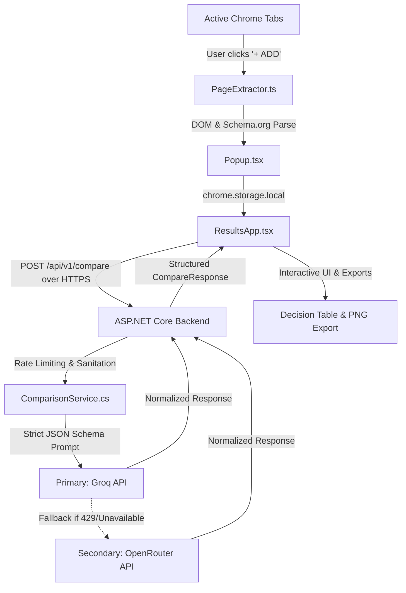

# Compare Anything

> **Stop switching between tabs. Compare them.**

An AI-powered Chrome Extension (Manifest V3) that allows users to add 2–4 webpages from anywhere on the web and receive one clean, structured, side-by-side comparison table grounded strictly in the facts on those pages.

---

## Screenshot & Preview

<p align="center">
  
</p>

```
+-----------------------------------------------------------------------------------+
|  COMPARE ANYTHING                                                  [2/4 Pages]   |
+-----------------------------------------------------------------------------------+
|  [+ ADD TO COMPARISON]  (Click to capture active tab)                             |
|                                                                                   |
|  * Tab 1: MacBook Air M3 (apple.com)                               [x]            |
|  * Tab 2: Dell XPS 13 (dell.com)                                   [x]            |
|                                                                                   |
|  What matters to you? (optional):                                                 |
|  [ Find the lightest laptop with the best battery life                ]           |
|                                                                                   |
|  [ COMPARE (2 TABS) -> ]                                                          |
+-----------------------------------------------------------------------------------+
```

---

## What It Does

People researching products, software, jobs, courses, or services normally suffer from "tab switching fatigue":
- Tab 1 → Read specifications
- Tab 2 → Read features
- Tab 3 → Try to recall pricing and details
- Mind → Mental overload and messy notes

**Compare Anything** solves this by normalizing web content across disparate websites into one objective decision matrix:
- **Universal Cross-Domain Comparison**: Compare laptop vs. laptop, SaaS pricing plans, hotel amenities, university courses, job offers, and more.
- **Evidence-Based Extraction**: Extracts Schema.org/JSON-LD, specification tables, definition lists, and key visible text while stripping navigation bars, ads, cookie banners, and footers.
- **Strict Grounding (No Hallucinations)**: Grounded exclusively in the provided page snapshots. Missing data is cleanly marked as `"Not stated"`, never guessed or hallucinated.
- **Personalized Prioritization**: Optional user goals bias the comparison criteria and trade-off highlights.
- **Actionable Decision Output**: Features a **Quick Verdict** (best overall or balanced trade-off), **Best For** category recommendations, **Key Differences**, and a structured **Comparison Table**.
- **Multi-Format Export**: Export comparisons as **Markdown**, **CSV**, or download a shareable high-resolution **PNG infographic**.

---

## Architecture



### Key Security & Architectural Principles
1. **API Keys Backend-Only**: LLM API keys (`GROQ_API_KEY`, `OPENROUTER_API_KEY`) reside exclusively in the server environment. The extension bundle contains zero secrets.
2. **Minimal Manifest V3 Permissions**: Requests only `activeTab`, `scripting`, and `storage`. Zero invasive background watchers or `<all_urls>` host permissions.
3. **HTTPS Enforcement**: All remote API communications are strictly enforced over HTTPS/TLS.

---

## Installation

### Load the Extension in Google Chrome
1. Clone this repository:
   ```bash
   git clone https://github.com/jyoti741/jyotiextension.git
   cd jyotiextension
   ```
2. Install frontend dependencies and build the extension:
   ```bash
   npm install
   npm run build:extension
   ```
3. Open Google Chrome and navigate to:
   ```text
   chrome://extensions
   ```
4. Enable **"Developer mode"** in the top right corner.
5. Click **"Load unpacked"** and select the `dist/` directory inside this repository.
6. The **Compare Anything ("C")** icon will appear in your Chrome extensions toolbar.

---

## Local Development

### Prerequisites
- **Node.js**: v18.12.0 or higher
- **.NET SDK**: .NET 8.0 SDK
- **Web Browser**: Google Chrome or Chromium-based browser

### Frontend Extension Commands
```bash
# Install dependencies
npm install

# Compile extension bundle (outputs to dist/ and mirrors to assets/)
npm run build:extension

# Package extension into production ZIP for Chrome Web Store
npm run package:extension
```

---

## Backend Setup

The comparison engine is powered by an ASP.NET Core 8 Web API located in `backend/`.

### 1. Run the Backend API
```bash
cd backend
dotnet restore
dotnet run
```
The backend will launch and listen locally at:
```text
http://localhost:5100
```
Swagger API documentation is accessible at:
```text
http://localhost:5100/swagger
```

### 2. Run Automated Test Suite
```bash
dotnet test backend.Tests/backend.Tests.csproj
```

---

## Environment Variables

Create a `.env` file in the project root (copied from `.env.example`).

> **CRITICAL SECURITY NOTICE:**  
> Never commit your real `.env` file or API keys to git. `.env` is ignored by `.gitignore`.

```env
# AI Inference API Keys (Server-side only)
GROQ_API_KEY=your_groq_api_key_here
OPENROUTER_API_KEY=your_openrouter_api_key_here

# ASP.NET Core Hosting (Optional override)
ASPNETCORE_URLS=http://localhost:5100
ASPNETCORE_ENVIRONMENT=Development
```

---

## Privacy Approach

Compare Anything adheres strictly to privacy-by-design and Chrome Web Store User Data policies:

1. **User Action Triggers Only**: Webpage content is accessed **only when the user explicitly clicks "+ ADD TO COMPARISON"**. The extension never scans browsing history or background tabs.
2. **Zero Permanent Page Storage**: Extracted page text is stored temporarily in `chrome.storage.local` during an active comparison session and is purged upon clearing or completing comparisons.
3. **No Advertising or Behavioral Profiling**: User data is never sold, rented, monetized, or used for advertising.
4. **Transparent Telemetry**: Server logs record only anonymous operational metadata (timestamp, hashed anonymous install ID, page count, and latency). Raw page URLs and content are never written to disk logs.
5. See [docs/PRIVACY.md](docs/PRIVACY.md) for the complete 9-point Privacy Policy.

---

## Contributors

- **Jyoti** ([@jyoti741](https://github.com/jyoti741)) — Creator & Maintainer
- Contributions, bug reports, and feature requests are welcome via GitHub Issues.

---

## License

This project is licensed under the **MIT License** — see the [LICENSE](LICENSE) file for details.
